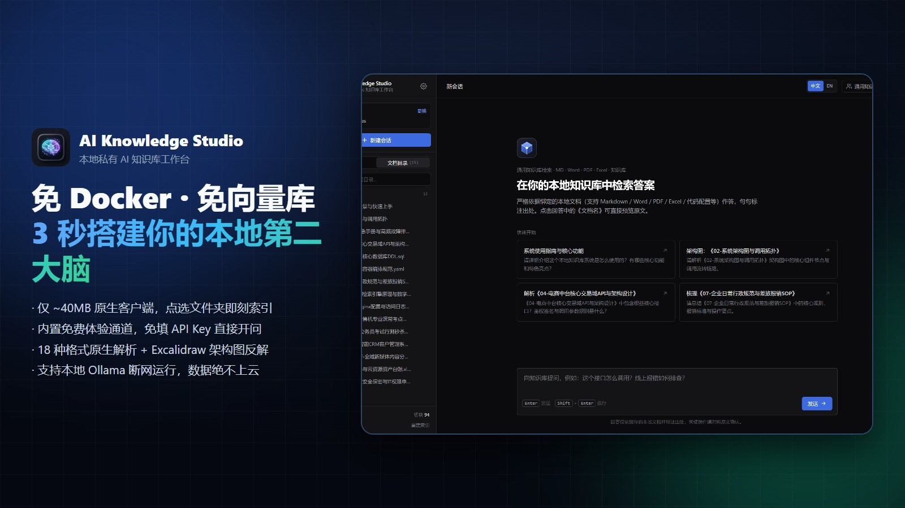
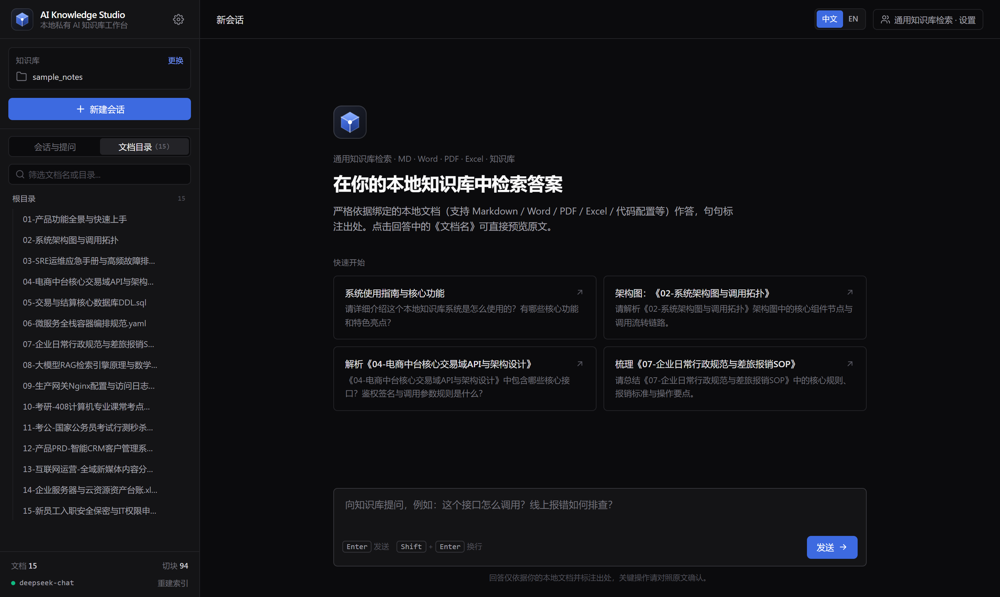
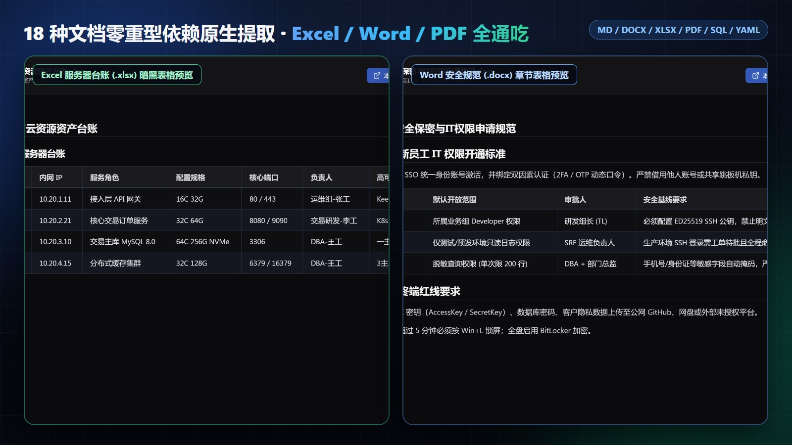
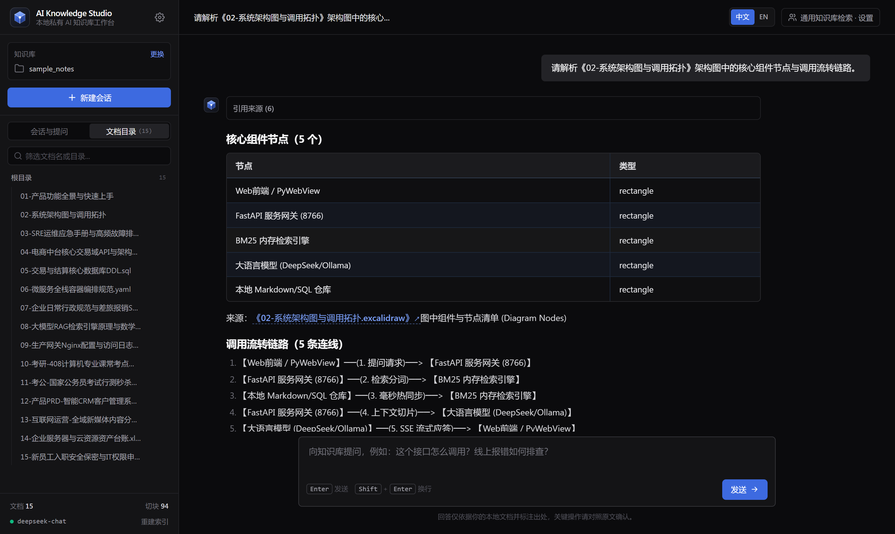
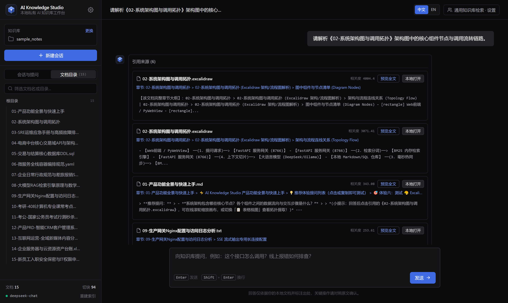
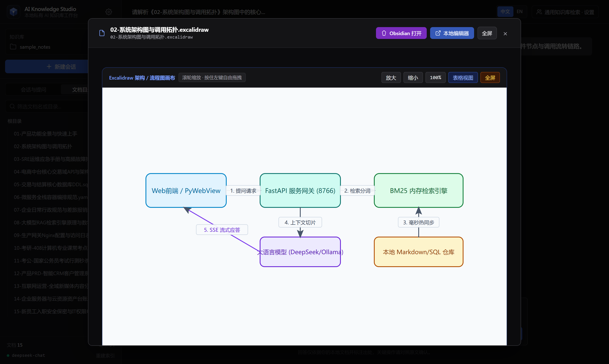
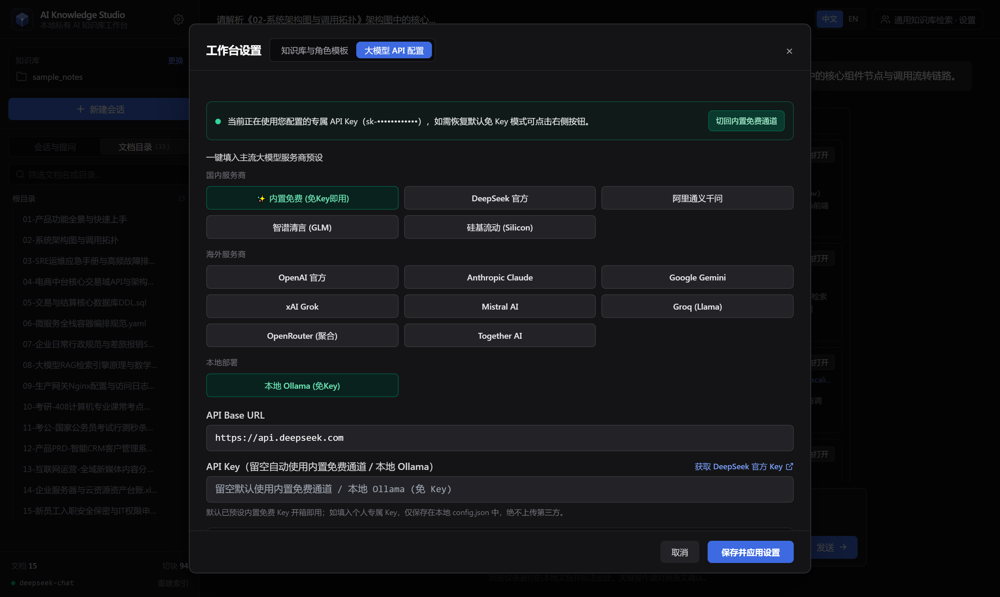
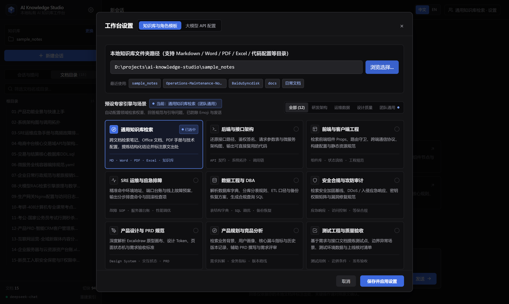

# AI Knowledge Studio —— 不用配环境、100% 跑在本地的私有知识库工具

> 做这个小工具的初衷很纯粹：**我实在受够了为了本地搜个笔记，还得装 Docker、配 Python 环境和折腾复杂的向量数据库了。**

- 🚀 **最新版本下载**：[前往 GitHub Releases 页面](https://github.com/amigo267/AI-Knowledge-Studio/releases)（提供 Windows 安装版、绿色便携版与 SHA-256 校验文件）

---

### 一、我为什么要做这个工具？

作为一个重度 Markdown / Obsidian 用户，随着笔记和办公资料积累到几千篇，日常经常遇到几个让人非常抓狂的事情：

1. **找东西像大海捞针**：明明记得记录过某个调优参数、制度条款或排障命令，但普通搜索只能跳出一堆文件名，人工逐篇点开翻找非常耗时。
2. **私密和商业数据不敢碰公有云**：公司项目的架构图、线上接口规范、服务器台账、内部制度和个人私密笔记，根本不敢上传到公网的云端 AI 知识库。
3. **开源工具太重、门槛太高**：市面上主流开源 RAG 项目（如 Docker + 向量库方案），动辄拉取数 GB 镜像、端口冲突、常驻内存吃掉 4G~8G+，普通轻薄本根本跑不顺畅。
4. **自己画的架构图成了盲区**：在 Obsidian 或画板里用 Excalidraw 画了大量业务流程图和系统架构图，绝大多数工具只认纯文本，完全看不懂图里的节点和箭头拓扑。

为了彻底解决这些痛点，我写了一款独立的 Windows 原生轻量桌面客户端 —— **约 40MB、免配环境、开箱即用，所有文档与检索计算全部留在你自己的电脑里。**

---

### 二、核心功能与实机效果

#### 1. 像选文件夹一样简单，3 秒建立本地索引

无需 Docker、无需 Python 环境、无需外部向量数据库。打开软件点击左上角「更换」，选中你电脑里的任意本地文件夹或 Obsidian 仓库（全面支持中文路径无乱码），几秒内即可完成纯内存索引。

原生零重型依赖支持 **18 种常见格式**：`.md`、`.excalidraw`、`.docx`、`.xlsx`、`.csv`、`.pdf`、`.txt`、`.sql`、`.yaml`、`.yml`、`.json`、`.py`、`.conf`、`.ini`、`.sh`、`.xml`、`.properties`、`.toml`。

#### 2. 回答严格基于本地文档，句句标注原文出处

底层基于 **Jieba 分词 + 改良 BM25 + 多词共现倍增 + 3 行滑动窗口近邻加权**，并做严格的防幻觉规则约束：

- 文档里写的端口、IP、配置参数、代码与条款逐字原样提取，绝不擅自脑补；
- 回答中附带可点击的行内文档链接与展开式「引用来源」卡片（含相关度评分、章节路径、「预览全文」与「本地打开」）；
- 文档中未记载的内容会明确告知“知识库未记载”，不胡编乱造。

#### 3. 笔记改动 3ms 自动热更新，随写随问

闲置时 0 后台轮询、不占 CPU；当你在 Obsidian、Word 或本地编辑器里保存了最新内容，切回软件敲回车提问的瞬间，引擎会在 **3 毫秒内** 基于 `mtime` 自动探测目录改动并静默重载索引，无需手动点刷新。

#### 4. 独家支持 Excalidraw 架构图与流程图拓扑反解

自动解析 `.excalidraw` 与 Obsidian `.excalidraw.md`（含 LZString Base64 压缩格式），提取图形节点文本、模块名称与箭头连线方向供大模型深度理解；点击引用即可在弹窗内滚轮无极缩放、拖拽平移、切换「表格视图」，或一键唤起 Obsidian / 本地编辑器继续修改。

#### 5. 内置免费体验通道（免 Key 即用）+ 本地 Ollama 纯断网离线

- **新手零门槛**：默认内置免费 AI 体验通道，刚打开软件无需申请 API Key 即可直接基于演示库或自有文件夹提问；
- **云端多模型一键切换**：内置 DeepSeek、阿里通义千问、智谱 GLM、硅基流动、OpenAI、Anthropic Claude、Google Gemini、xAI Grok 等 **14 款主流服务商预设**；
- **100% 物理断网私密模式**：原生支持 **本地 Ollama（免 Key）**，拔掉网线、关掉 Wi-Fi 照样流畅检索问答，核心数据零上传公网。

#### 6. 内置 12 套行业专家角色预设与多库秒切

在工作台设置中记住「最近使用」目录实现多知识库秒级切换，并内置 **12 套专业场景模板**（支持高级自定义标题、提示词与检索加权词）：

- **团队通用**：通用知识库检索、企业流程与新人带教、技术支持与交付实施；
- **研发架构**：后端与接口架构、前端与客户端工程、技术方案评审与 ADR；
- **运维数据**：SRE 运维与应急排障、数据工程与 DBA、安全合规与攻防审计；
- **设计质量**：产品设计与 PRD 规范、产品规划与竞品分析、测试工程与质量验收。

---

### 三、方案横向对比

| 对比项 | 云端知识库（在线笔记 AI 等） | 开源自建（Docker / 向量库方案） | **AI Knowledge Studio（本工具）** |
| :--- | :--- | :--- | :--- |
| **安装方式** | 网页登录上传 | 装 Docker、配环境、拉数 GB 镜像 | **约 40MB 单机运行，零外部环境依赖** |
| **内容改动同步** | 修改后常需重新上传 | 需手动触发重新切片向量化 | **改完直接提问，后台 3ms 自动热更新** |
| **数据安全性** | 文件上传第三方服务器 | 需自行维护服务器与权限隔离 | **文档留存本机，支持 Ollama 物理断网** |
| **图文解析** | 仅支持纯文本 | 绝大多数只支持纯文本 | **独家支持 Excalidraw 画布拓扑反解** |
| **文档格式** | 偏纯笔记格式 | 需配置重型解析插件 | **原生支持 18 种办公、代码与画布格式** |
| **系统资源占用** | 依赖浏览器标签页 | 内存常驻 4G~8G+，风扇狂转 | **纯内存轻量引擎，轻薄本流畅秒开** |

---

### 四、下载与快速上手

#### 方式 A：通过 GitHub Releases 下载（推荐）
前往 **[GitHub Releases 页面](https://github.com/amigo267/AI-Knowledge-Studio/releases)** 获取最新版安装包与校验文件：
- **Windows 标准安装版**：`AI_Knowledge_Studio_Setup_v1.0.exe`（自动创建桌面快捷方式与卸载入口）
- **Windows 绿色便携版**：`LocalKnowledgeAI_v1.0_Portable.zip`（解压双击 `LocalKnowledgeAI.exe` 直接运行，免安装无残留）

#### 方式 B：国内高速直链下载
- **安装版**：https://osstest.yoximi.com/soft/knowledge/AI_Knowledge_Studio_Setup_v1.0.exe
- **绿色便携版**：https://osstest.yoximi.com/soft/knowledge/LocalKnowledgeAI_v1.0_Portable.zip

#### 两步极速开始
1. 运行安装程序，或解压绿色包后双击 `LocalKnowledgeAI.exe`（内置 15 份多格式开箱演示文档，启动即可直接点首页卡片体验）；
2. 点击左上角「更换」绑定你自己的笔记或办公文档文件夹，即可开始提问。

---

### ❓ 常见问题（FAQ）

- **Q：我的电脑配置不高，能流畅运行吗？**  
  A：可以。客户端仅约 40MB，无外部向量数据库常驻开销，采用纯内存轻量检索引擎，普通办公轻薄本也能流畅运行。
- **Q：我的文档数据会上传到第三方服务器吗？**  
  A：文档解析、切片与检索完全在本机内存执行；在设置中切换至 **本地 Ollama（免 Key）** 后，可在完全拔网线的物理离线环境下问答，零字节上传公网。
- **Q：支持哪些文档格式？修改文档后需要重新导入吗？**  
  A：原生支持 Markdown、Excalidraw、Word (`.docx`)、Excel (`.xlsx`/`.csv`)、文字版 PDF、SQL、YAML、JSON、Python、Nginx/INI/TOML/Shell 等 18 种格式；外部修改保存后无需重新导入，提问时 3ms 自动热更新。

---

*项目由个人独立持续维护，欢迎提交 Issue 交流需求或点亮 Star 支持。*
